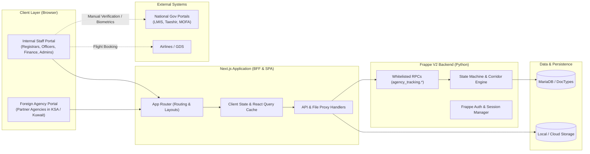
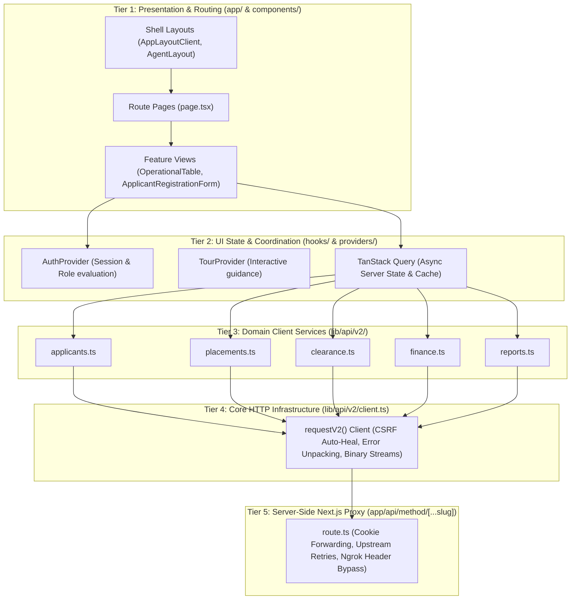

# 01 — System Architecture & Architectural Principles

This document explains the **Travel Agency Workflow** platform from the outside in. It defines the system's operational boundaries, architectural layers, core data relationships, technology choices, and cross-cutting engineering concerns.

---

## 1. System Purpose & Operational Boundaries

The system is an overseas recruitment workflow platform tailored to the legal and operational pipeline of placing Ethiopian domestic and technical workers into the Kingdom of Saudi Arabia (KSA) and the State of Kuwait.

### Clear Distribution of Responsibilities

| Responsibility Area | Handled by Frontend (Next.js) | Handled by Backend (Frappe V2) | Status / Basis |
| :--- | :--- | :--- | :--- |
| **Authentication** | Renders login page, enforces route guards, manages UI session context (`AuthProvider`). | Validates password hashes, creates signed session cookies (`sid`), generates CSRF tokens. | **Confirmed** (Source: `client.ts`, `route.ts`, `auth.ts`) |
| **Authorization (RBAC)**| Hides inaccessible navigation and buttons; redirects unauthorized URLs. | **Authoritative security gate.** Validates roles on every RPC method call. | **Confirmed** (Source: `permissions.ts`, `roles.py`, `v2Roles.ts`) |
| **State Transitions** | Triggers transition actions by sending target RPC payloads. Never alters status directly. | **Authoritative State Machine.** Validates legal transition edges, stage gates, and audit logs. | **Confirmed** (Source: `state_machine.py`, `placements.ts`) |
| **Corridor Definition** | Dynamically renders steps returned by backend RPCs. | Stores corridor steps in `Corridor Definition` DocType; sequences clearance stages. | **Confirmed** (Source: `corridor_engine.py`, `corridor.ts`) |
| **Document OCR** | Client-side Optical Character Recognition on passport Machine Readable Zones (MRZ). | Stores uploaded image files and metadata; validates passport number uniqueness. | **Confirmed** (Source: `mrzScanner.ts`, `tesseract.js`) |
| **PDF CV Generation** | Client-side visual rendering and PDF assembly (`jsPDF`, `html2canvas-pro`). | Optional server-side HTML/PDF rendering via Weasyprint (`cv_api.render_cv_pdf`). | **Confirmed** (Source: `cvPdfGenerator.ts`, `cv.ts`) |
| **Data Persistence** | Short-lived in-memory React Query cache and local UI form state. | MariaDB relational database managed by Frappe DocTypes. | **Confirmed** (Source: `QueryProvider.tsx`, Frappe ORM) |

---

## 2. Architectural Layers

The frontend application is structured into five distinct architectural tiers:

### Detailed Layer Specifications

### 1. Presentation & Routing Layer (`src/app/`, `src/components/`)
- **Responsibility:** Render UI, capture user interactions, manage local UI state (modals, active tabs, form inputs), and provide responsive layouts.
- **Rules:**
  - Must never construct raw HTTP calls directly inside JSX.
  - Must never mutate business records without going through service functions.
  - Must delegate table sorting, filtering, and paging to dedicated components.

### 2. State & Coordination Layer (`src/components/providers/`, TanStack Query)
- **Responsibility:** Maintain session identity, evaluate user permissions, cache server queries, deduplicate network requests, and manage application tours.
- **Key Files:**
  - [`src/components/providers/AuthProvider.tsx`](file:///c:/Users/azwis/OneDrive/Desktop/Doc/Pro/Internship/Travel%20Agency%20Workflow/Travel%20Agency%20Frontend/travel_agency_workflow/src/components/providers/AuthProvider.tsx): Central user session and RBAC context.
  - [`src/components/providers/QueryProvider.tsx`](file:///c:/Users/azwis/OneDrive/Desktop/Doc/Pro/Internship/Travel%20Agency%20Workflow/Travel%20Agency%20Frontend/travel_agency_workflow/src/components/providers/QueryProvider.tsx): Configures TanStack Query with aggressive cache windows (5-minute stale time) to eliminate redundant refetches.

### 3. Domain Client Services Layer (`src/lib/api/v2/`)
- **Responsibility:** Encapsulate domain-specific backend endpoints. Map frontend parameters into sanctioned backend payloads.
- **Key Files:**
  - [`applicants.ts`](file:///c:/Users/azwis/OneDrive/Desktop/Doc/Pro/Internship/Travel%20Agency%20Workflow/Travel%20Agency%20Frontend/travel_agency_workflow/src/lib/api/v2/applicants.ts): Intake, registration, and directory queries.
  - [`placements.ts`](file:///c:/Users/azwis/OneDrive/Desktop/Doc/Pro/Internship/Travel%20Agency%20Workflow/Travel%20Agency%20Frontend/travel_agency_workflow/src/lib/api/v2/placements.ts): Placement creation, advancing, flight booking, and departures.
  - [`clearance.ts`](file:///c:/Users/azwis/OneDrive/Desktop/Doc/Pro/Internship/Travel%20Agency%20Workflow/Travel%20Agency%20Frontend/travel_agency_workflow/src/lib/api/v2/clearance.ts): Country-specific clearance steps (LMIS, Taeshir, Embassy, Telesign).
  - [`finance.ts`](file:///c:/Users/azwis/OneDrive/Desktop/Doc/Pro/Internship/Travel%20Agency%20Workflow/Travel%20Agency%20Frontend/travel_agency_workflow/src/lib/api/v2/finance.ts): FX rates, expenses, commissions, and refunds.
  - [`reports.ts`](file:///c:/Users/azwis/OneDrive/Desktop/Doc/Pro/Internship/Travel%20Agency%20Workflow/Travel%20Agency%20Frontend/travel_agency_workflow/src/lib/api/v2/reports.ts): Operational analytics, staff performance, and export generation.

### 4. Core HTTP Infrastructure Layer (`src/lib/api/v2/client.ts`)
- **Responsibility:** Execute network requests, manage CSRF lifecycle, handle file downloads, unpack Frappe response structures, and format human-readable error messages.
- **Key Features:**
  - **CSRF Auto-Heal:** Intercepts `CSRFTokenError` exceptions, invalidates cached tokens, fetches a fresh token, and retries the failed operation transparently.
  - **Binary Stream Detection:** Detects Excel (`.xlsx`), CSV, and PDF content types and converts responses into browser `Blob` objects with extracted filenames.
  - **Error Unpacking:** Extracts the root message from Frappe `_server_messages`, `exc`, `exception`, and `message` payloads, converting cryptic database errors into actionable user feedback.

### 5. Server-Side Proxy Layer (`src/app/api/method/[...slug]/route.ts`)
- **Responsibility:** Act as a server-side gateway between the browser and the upstream Frappe backend.
- **Key Features:**
  - **Cookie Sanitization:** Forwards the `sid` session cookie with `SameSite=Lax` and dynamic `Secure` flags.
  - **Upstream Resilience:** Automatically retries transient network failures up to 2 times with exponential backoff.
  - **Development Tunnel Support:** Automatically injects `ngrok-skip-browser-warning` when local development tunnels are used.

---

## 3. Technology Choices & Evaluation

| Library / Tool | Primary Responsibility | Practical Benefit in this Codebase | What Breaks if Removed? |
| :--- | :--- | :--- | :--- |
| **Next.js 16 (App Router)** | Framework & Server Runtime | Handles hybrid SSR/client rendering, nested route layouts (`/agent` vs `/dashboard`), and the secure BFF proxy. | Complete architectural collapse. All API routing, cookie handling, and page routing would need manual rewrites. |
| **React 19** | Component Engine | Provides modern hook primitives (`useActionState`, `useOptimistic`, transitions) and high-performance component reconciliation. | UI cannot render. |
| **Tailwind CSS 4** | Styling System | Zero-runtime CSS utility engine with modern `@theme` variables for instantaneous dark/light mode switching. | Entire visual hierarchy, responsiveness, and layout styling would break. |
| **@tanstack/react-query** | Server State Cache | Eliminates duplicate network requests, manages background polling, and provides automatic cache invalidation on mutations. | The frontend would execute hundreds of duplicate API requests per minute, risking rate limits and lag. |
| **@tanstack/react-table** | Headless Table Logic | High-performance table state (sorting, pagination, column visibility) without tying styling to third-party CSS. | The operational workspace tables (handling 500+ candidate rows) would lose sorting and pagination. |
| **React Hook Form + Zod** | Form State & Validation | High-performance uncontrolled form handling that validates complex 5-step registration data without laggy re-renders. | Candidate registration form would drop input keystrokes and suffer severe re-render lag. |
| **jsPDF / pdf-lib** | Client PDF Generation | Assembles high-resolution candidate CV profiles directly in the browser without relying on external cloud converters. | CV download feature would fail unless an expensive backend Weasyprint service is deployed. |
| **Tesseract.js** | Client OCR | Reads passport Machine Readable Zones (MRZ) directly on the client machine to auto-fill candidate registration. | Manual entry would be required for all passport fields; registrars would lose auto-fill capabilities. |

---

## 4. System-Wide Cross-Cutting Concerns

### A. Authentication & Session Management
- **Mechanism:** HTTP-only session cookies (`sid`).
- **Flow:** User submits credentials to `POST /api/method/login`. The Frappe backend validates credentials and issues a session cookie. The Next.js proxy forwards the cookie to the browser with sanitized `SameSite=Lax` attributes.
- **State Restoration:** Upon page reload, [`AuthProvider.tsx`](file:///c:/Users/azwis/OneDrive/Desktop/Doc/Pro/Internship/Travel%20Agency%20Workflow/Travel%20Agency%20Frontend/travel_agency_workflow/src/components/providers/AuthProvider.tsx) calls `fetchCurrentUserContext()`. If the cookie is valid, the user's email, full name, and roles are restored without requiring re-login.

### B. Authorization & Role-Based Access Control (RBAC)
- **Role Model:** 16 canonical roles defined in [`src/lib/auth/v2Roles.ts`](file:///c:/Users/azwis/OneDrive/Desktop/Doc/Pro/Internship/Travel%20Agency%20Workflow/Travel%20Agency%20Frontend/travel_agency_workflow/src/lib/auth/v2Roles.ts).
- **Route Guarding:** [`ROUTE_PERMISSION_MAP`](file:///c:/Users/azwis/OneDrive/Desktop/Doc/Pro/Internship/Travel%20Agency%20Workflow/Travel%20Agency%20Frontend/travel_agency_workflow/src/lib/auth/permissions.ts#L335-L347) enforces role checks on every route navigation. If an unauthorized user attempts to visit `/employees` or `/expenses-income`, they are redirected to `/dashboard` with an access-denied toast.
- **Portal Isolation:** Foreign Agency users holding the `Foreign Agency` role are isolated to `/agent/*` and forbidden from viewing internal staff tools or employee records.

### C. State Machine & Pipeline Progress
- **Enforcement:** All applicant and placement progressions follow strict directed acyclic graph (DAG) transitions defined in `state_machine.py`.
- **Pipeline:** `Draft` ➔ `Registered` ➔ `CV Generated` ➔ `Selected` ➔ `Parallel Streams (LMIS/Injaz)` ➔ `Visa Issued` ➔ `Flight Ticket` ➔ `Departed`.
- **Stage Gates:** Medical checks (`medical_status == "FIT"`) and police clearances are required gates before advancing. Managers can force progression only via authorized written overrides.

### D. Responsive Layout & Viewport Sizing
- **Scrolling Policy:** The main content wrapper in [`AppLayoutClient.tsx`](file:///c:/Users/azwis/OneDrive/Desktop/Doc/Pro/Internship/Travel%20Agency%20Workflow/Travel%20Agency%20Frontend/travel_agency_workflow/src/components/layout/AppLayoutClient.tsx) uses `flex-1 min-h-0 overflow-y-auto`. Content scrolls naturally whenever it exceeds the screen height, eliminating viewport clipping while keeping sidebars and top bars sticky.
- **Chat & Split-Panes:** Uses flexible container bounds (`flex-1 min-h-0 h-full`) rather than brittle fixed pixel heights.

---

## 5. Architectural Findings: Confirmed vs. Inferred vs. Unknown

To maintain strict engineering rigor, this section distinguishes between verified facts, informed deductions, and unavailable data:

| Aspect | Classification | Evidence / Basis |
| :--- | :--- | :--- |
| **Whitelisted RPC Enforcement** | **Confirmed** | Explicitly coded in [`client.ts`](file:///c:/Users/azwis/OneDrive/Desktop/Doc/Pro/Internship/Travel%20Agency%20Workflow/Travel%20Agency%20Frontend/travel_agency_workflow/src/lib/api/v2/client.ts#L101-L107) and documented in `BUSINESS_AND_SYSTEM_DOCUMENTATION.md`. |
| **State Machine Gating** | **Confirmed** | Backend state transition tables and gate overrides documented in `BUSINESS_AND_SYSTEM_DOCUMENTATION.md` (§1). |
| **Dynamic Corridor Step Configuration** | **Confirmed** | Frontend calls `agency_tracking.corridor_engine.get_corridor_steps` dynamically rather than hardcoding steps. |
| **Database Physical Indexing** | **Inferred** | Uniqueness on `passport_number` and `labor_id` is enforced in application code (`validate()`), suggesting MariaDB unique constraints were omitted to allow empty draft values. |
| **Upstream Queue Workers** | **Unknown** | The frontend communicates via synchronous HTTP RPCs; whether background tasks use Redis Queue, Celery, or RQ is an internal backend detail not exposed in the frontend repository. |
