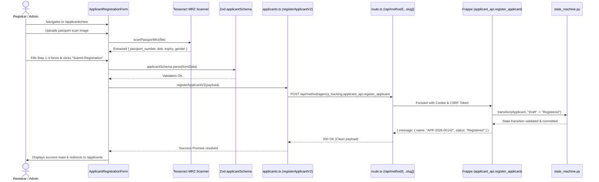
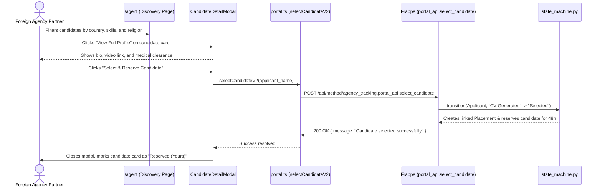
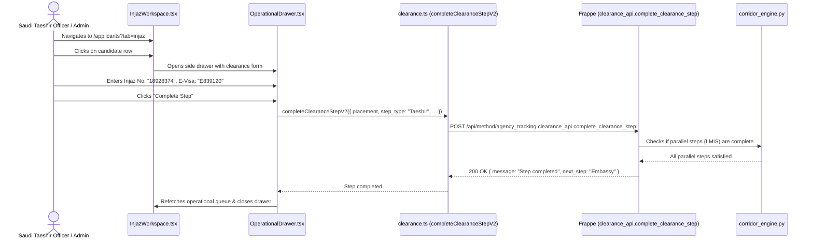

# 04 — End-to-End Feature Walkthroughs

This document traces the complete, end-to-end execution chains of the **primary business workflows** in the Travel Agency Workflow application.

Every workflow is followed step-by-step from the initial user button click through component state, validation, API proxying, backend state machine transitions, database mutation, and UI re-rendering.

---

## Workflow 1: Applicant Intake, Passport OCR, & Registration

This workflow takes a new job candidate from intake to an officially registered applicant.

### Complete Execution Chain

1. **User Role:** `Registrar` or `Admin` (enforced via `can("registerApplicant")`).
2. **Route:** `/applicants/new`.
3. **Layout Wrapper:** [`AppLayoutClient.tsx`](file:///c:/Users/azwis/OneDrive/Desktop/Doc/Pro/Internship/Travel%20Agency%20Workflow/Travel%20Agency%20Frontend/travel_agency_workflow/src/components/layout/AppLayoutClient.tsx).
4. **Primary Component:** [`src/components/applicant/ApplicantRegistrationForm.tsx`](file:///c:/Users/azwis/OneDrive/Desktop/Doc/Pro/Internship/Travel%20Agency%20Workflow/Travel%20Agency%20Frontend/travel_agency_workflow/src/components/applicant/ApplicantRegistrationForm.tsx).
5. **Child Steps Involved:**
   - [`Step1PersonalInfo.tsx`](file:///c:/Users/azwis/OneDrive/Desktop/Doc/Pro/Internship/Travel%20Agency%20Workflow/Travel%20Agency%20Frontend/travel_agency_workflow/src/components/applicant/steps/Step1PersonalInfo.tsx): Name, gender, destination country, target job.
   - [`Step2EducationExperience.tsx`](file:///c:/Users/azwis/OneDrive/Desktop/Doc/Pro/Internship/Travel%20Agency%20Workflow/Travel%20Agency%20Frontend/travel_agency_workflow/src/components/applicant/steps/Step2EducationExperience.tsx): Education level, domestic/international experience.
   - [`Step3IdentificationContact.tsx`](file:///c:/Users/azwis/OneDrive/Desktop/Doc/Pro/Internship/Travel%20Agency%20Workflow/Travel%20Agency%20Frontend/travel_agency_workflow/src/components/applicant/steps/Step3IdentificationContact.tsx): Passport scan upload, local OCR, National ID, Emergency contact.
   - [`Step4CocMedical.tsx`](file:///c:/Users/azwis/OneDrive/Desktop/Doc/Pro/Internship/Travel%20Agency%20Workflow/Travel%20Agency%20Frontend/travel_agency_workflow/src/components/applicant/steps/Step4CocMedical.tsx): COC certification and initial medical exam result (`FIT`).
   - [`Step5Review.tsx`](file:///c:/Users/azwis/OneDrive/Desktop/Doc/Pro/Internship/Travel%20Agency%20Workflow/Travel%20Agency%20Frontend/travel_agency_workflow/src/components/applicant/steps/Step5Review.tsx): Summary review table and final confirmation.
6. **Trigger:** User clicks `"Submit Registration"` button on Step 5.
7. **Handler:** `onSubmit` in `ApplicantRegistrationForm.tsx`.
8. **Form & Validation Logic:**
   - Validates data against [`applicantSchema`](file:///c:/Users/azwis/OneDrive/Desktop/Doc/Pro/Internship/Travel%20Agency%20Workflow/Travel%20Agency%20Frontend/travel_agency_workflow/src/lib/validations/applicant.schema.ts).
   - Verifies required floor: `full_name`, `gender`, `passport_number`, `destination_country`, `medical_status == "FIT"`.
9. **Service Call:** `registerApplicantV2(cleanedPayload)` in [`src/lib/api/v2/applicants.ts`](file:///c:/Users/azwis/OneDrive/Desktop/Doc/Pro/Internship/Travel%20Agency%20Workflow/Travel%20Agency%20Frontend/travel_agency_workflow/src/lib/api/v2/applicants.ts).
10. **Endpoint Called:** `POST /api/method/agency_tracking.applicant_api.register_applicant`.
11. **Backend Handling:**
    - Checks `passport_number` and `labor_id` uniqueness across all existing records.
    - Transitions document status from `Draft` to `Registered` using `state_machine.py`.
    - Logs an immutable `Process Event` audit record.
12. **UI State Transitions:**
    - Loading state: Button displays `<Loader2 className="animate-spin" />` with `"Registering..."`.
    - Success state: Invalidation of `["applicants"]` query cache via `queryClient.invalidateQueries()`. Displays green Sonner toast `"Applicant successfully registered"`. Redirects to `/applicants`.
    - Error state: Catches `ApiV2Error` (e.g. duplicate passport number), highlights the error banner on the form, and prevents navigation.

---

## Workflow 2: Foreign Partner Candidate Selection & Reservation

This workflow demonstrates how an overseas partner recruitment agency in Saudi Arabia or Kuwait selects a candidate.

### Complete Execution Chain

1. **User Role:** `Foreign Agency` (enforced via [`isV2ForeignAgency()`](file:///c:/Users/azwis/OneDrive/Desktop/Doc/Pro/Internship/Travel%20Agency%20Workflow/Travel%20Agency%20Frontend/travel_agency_workflow/src/lib/auth/v2Roles.ts#L95-L101)).
2. **Route:** `/agent` (or `/agent/discovery`).
3. **Layout Wrapper:** [`AgentLayout.tsx`](file:///c:/Users/azwis/OneDrive/Desktop/Doc/Pro/Internship/Travel%20Agency%20Workflow/Travel%20Agency%20Frontend/travel_agency_workflow/src/components/agent/AgentLayout.tsx).
4. **Primary Components:**
   - [`src/app/agent/page.tsx`](file:///c:/Users/azwis/OneDrive/Desktop/Doc/Pro/Internship/Travel%20Agency%20Workflow/Travel%20Agency%20Frontend/travel_agency_workflow/src/app/agent/page.tsx).
   - [`CandidateCard.tsx`](file:///c:/Users/azwis/OneDrive/Desktop/Doc/Pro/Internship/Travel%20Agency%20Workflow/Travel%20Agency%20Frontend/travel_agency_workflow/src/components/agent/CandidateCard.tsx).
   - [`CandidateDetailModal.tsx`](file:///c:/Users/azwis/OneDrive/Desktop/Doc/Pro/Internship/Travel%20Agency%20Workflow/Travel%20Agency%20Frontend/travel_agency_workflow/src/components/agent/CandidateDetailModal.tsx).
5. **Trigger:** Partner agency clicks `"Select & Reserve Candidate"` in the detail modal.
6. **Handler:** `handleSelectCandidate` in `CandidateDetailModal.tsx`.
7. **Service Call:** `selectCandidateV2(candidate.name)` in [`src/lib/api/v2/portal.ts`](file:///c:/Users/azwis/OneDrive/Desktop/Doc/Pro/Internship/Travel%20Agency%20Workflow/Travel%20Agency%20Frontend/travel_agency_workflow/src/lib/api/v2/portal.ts).
8. **Endpoint Called:** `POST /api/method/agency_tracking.portal_api.select_candidate`.
9. **Backend Handling:**
   - Identifies the authenticated partner agency via session contractor mapping (`get_contractor_from_user`).
   - Validates candidate eligibility (candidate must be in `CV Generated` status and not currently reserved by another agency).
   - Transitions candidate status to `Selected`.
   - Generates a new `Placement` record linking candidate to contractor.
   - Enters candidate into the internal agency's `Selection Requests` workspace.
10. **UI Updates:**
    - Modal closes.
    - Candidate is moved into `/agent/reserved`.
    - Internal agency registrars are notified of a new selection request via WebSocket/Polling.

---

## Workflow 3: Clearance Step Execution (e.g. Saudi Injaz / Taeshir)

This workflow shows how an operational clearance officer logs a government visa approval step.

### Complete Execution Chain

1. **User Role:** `Saudi Taeshir`, `Clearance Officer`, or `Admin` (enforced via `can("editInjaz")`).
2. **Route:** `/applicants?tab=injaz`.
3. **Primary Component:** [`src/components/operational/workspaces/InjazWorkspace.tsx`](file:///c:/Users/azwis/OneDrive/Desktop/Doc/Pro/Internship/Travel%20Agency%20Workflow/Travel%20Agency%20Frontend/travel_agency_workflow/src/components/operational/workspaces/InjazWorkspace.tsx).
4. **Trigger:** Clearance officer inputs visa registration details and clicks `"Complete Step"`.
5. **Handler:** `handleSaveStep` in `InjazWorkspace.tsx`.
6. **Service Call:** `completeClearanceStepV2()` in [`src/lib/api/v2/clearance.ts`](file:///c:/Users/azwis/OneDrive/Desktop/Doc/Pro/Internship/Travel%20Agency%20Workflow/Travel%20Agency%20Frontend/travel_agency_workflow/src/lib/api/v2/clearance.ts).
7. **Endpoint Called:** `POST /api/method/agency_tracking.clearance_api.complete_clearance_step`.
8. **Backend Handling:**
   - Validates that previous sequential gates (LMIS Clearance) have been initiated or completed according to the dynamic corridor graph (`get_corridor_steps`).
   - Stores `injaz_number`, `visa_number`, and biometric timestamp on the `Clearance Step` record.
   - If this is the final parallel step in the clearance phase, automatically advances the placement status from `Parallel Streams` to `Visa Issued`.
9. **UI Updates:**
   - Candidate row moves out of the Injaz queue into the Embassy stamping queue.
   - TanStack query cache for `["operational-workspace"]` is automatically invalidated.

---

## Workflow 4: Flight Ticketing & Airport Departure

This workflow completes the placement lifecycle when a worker departs from Addis Ababa Bole International Airport.

1. **User Role:** `Ticketer` or `Admin` (enforced via `can("manageTicketing")`).
2. **Route:** `/applicants?tab=departure`.
3. **Primary Component:** [`DepartureWorkspace.tsx`](file:///c:/Users/azwis/OneDrive/Desktop/Doc/Pro/Internship/Travel%20Agency%20Workflow/Travel%20Agency%20Frontend/travel_agency_workflow/src/components/operational/workspaces/DepartureWorkspace.tsx) and [`TicketingDepartureModal.tsx`](file:///c:/Users/azwis/OneDrive/Desktop/Doc/Pro/Internship/Travel%20Agency%20Workflow/Travel%20Agency%20Frontend/travel_agency_workflow/src/components/applicant/TicketingDepartureModal.tsx).
4. **Step A (Ticketing):**
   - User inputs Airline (e.g. Ethiopian Airlines), Flight Number (`ET 402`), PNR, Departure Date, and uploads the electronic ticket PDF.
   - Calls `saveTicketingV2()` (`POST .../placement_api.save_ticketing`).
   - Placement advances to status: `Flight Ticket`.
5. **Step B (Departure):**
   - When the worker is physically verified at the airport dispatch gate, officer clicks `"Confirm Departure"`.
   - Calls `recordDepartureV2()` (`POST .../placement_api.record_departure`).
   - Backend transitions placement status to **`Departed`** (the terminal milestone of the deployment pipeline).
   - Backend triggers automated contractor commission calculation and moves the record into historical reporting.
