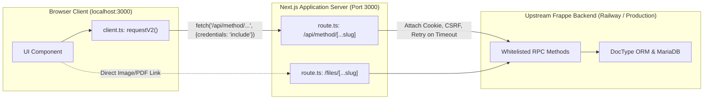
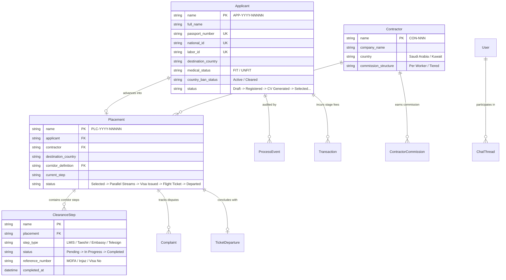

# 05 — API Architecture & Complete Data Flow

This document details how the frontend communicates with the backend, manages session security, handles binary streaming downloads, and translates backend data structures into responsive user interfaces.

---

## 1. Network Path & API Proxy Architecture

All frontend network traffic follows a **Backend-For-Frontend (BFF)** proxy pattern. The browser client never communicates directly with the upstream Frappe host; it communicates with the local Next.js server, which proxies the request upstream.

### Why the Proxy Architecture Exists

1. **Elimination of Cross-Origin (CORS) Issues:**
   The browser communicates with its own origin (`http://localhost:3000` or production domain). Browser CORS policies and third-party cookie restrictions are completely bypassed.
2. **Secure Cookie Handling:**
   The upstream backend sets a session cookie (`sid`). The proxy intercepts the `set-cookie` header, removes conflicting upstream domain restrictions, and attaches `SameSite=Lax` and dynamic `Secure` flags, allowing the browser to store and return the cookie reliably.
3. **Tunnel Interstitial Bypass:**
   During local development using tunneling tools (like Ngrok), the proxy automatically attaches `ngrok-skip-browser-warning: true`, preventing HTML warning interstitials from breaking JSON API calls.
4. **Resilience & Automatic Retries:**
   The proxy wraps upstream network requests in [`fetchWithRetry()`](file:///c:/Users/azwis/OneDrive/Desktop/Doc/Pro/Internship/Travel%20Agency%20Workflow/Travel%20Agency%20Frontend/travel_agency_workflow/src/app/api/method/%5B...slug%5D/route.ts#L50-L72), retrying transient network disconnects or gateway timeouts up to 2 times with exponential backoff before reporting an error.

---

## 2. Request Lifecycle & CSRF Security

Every state-changing operation (`POST`) requires two security tokens:
1. **The Session Cookie (`sid`):** Authenticates the identity of the user. Transmitted automatically by the browser via `credentials: "include"`.
2. **The CSRF Token (`X-Frappe-CSRF-Token`):** Prevents Cross-Site Request Forgery attacks.

### In-Memory CSRF Lifecycle & Auto-Healing

In [`src/lib/api/v2/client.ts`](file:///c:/Users/azwis/OneDrive/Desktop/Doc/Pro/Internship/Travel%20Agency%20Workflow/Travel%20Agency%20Frontend/travel_agency_workflow/src/lib/api/v2/client.ts#L33-L77):
- The client maintains an in-memory cache `cachedCsrfToken`.
- Before executing a `POST` request, `requestV2` checks if a token is cached. If not, it calls `GET /api/method/agency_tracking.auth_api.get_csrf_token`.
- **Auto-Healing Mechanism:** If the backend rejects a request with `CSRFTokenError` or an `"Invalid Request"` 400 error (which occurs when a session expires or switches users), `requestV2` catches the error, purges `cachedCsrfToken`, requests a fresh token, and automatically replays the original user request without showing an error to the user!

---

## 3. Error Unpacking & Formatting

Frappe backends return errors in various internal formats:
- In `_server_messages` (as a JSON string containing an array of serialized messages).
- In `exc` (as a multi-line Python traceback).
- In `exception` (e.g. `frappe.exceptions.ValidationError: Labor ID already exists`).
- In `message` (as a string or nested object).

[`src/lib/api/v2/client.ts`](file:///c:/Users/azwis/OneDrive/Desktop/Doc/Pro/Internship/Travel%20Agency%20Workflow/Travel%20Agency%20Frontend/travel_agency_workflow/src/lib/api/v2/client.ts#L254-L355) implements a priority extraction cascade:
1. Parses and extracts the text from `_server_messages`.
2. Checks `jsonResponse.message`.
3. Strips Python exception prefixes (e.g. converting `frappe.exceptions.ValidationError: Invalid Passport` to `Invalid Passport`).
4. Falls back to human-friendly HTTP status code messages (e.g. 403 maps to `"You have read-only access here, or your assigned role does not have authorization for this operation."`).

The clean message is wrapped into an `ApiV2Error` instance and thrown to the calling component.

---

## 4. Comprehensive Feature-to-API Endpoint Matrix

This matrix maps application features to their authoritative backend RPC endpoints:

| Feature / Domain | Frontend Service Caller | Backend Method (Endpoint) | HTTP Method | Request Payload / Params | Expected Response | Backend Responsibility |
| :--- | :--- | :--- | :--- | :--- | :--- | :--- |
| **User Sign In** | `loginUser(usr, pwd)` in `auth.ts` | `/api/method/login` | `POST` | `{ usr, pwd }` | `{ message: "Logged In", home_page: "..." }` | Validates hash, issues `sid` cookie. |
| **Who Am I Context** | `fetchCurrentUserContext()` in `auth.ts` | `agency_tracking.auth_api.get_current_user` | `GET` | *(None - reads cookie)* | `{ email, full_name, roles, contractor }` | Inspects session, resolves permissions. |
| **CSRF Token** | `getCachedOrFetchCsrfToken()` in `client.ts` | `agency_tracking.auth_api.get_csrf_token` | `GET` | *(None)* | `{ message: "csrf_token_string" }` | Issues cryptographic CSRF token. |
| **Register Candidate**| `registerApplicantV2()` in `applicants.ts` | `agency_tracking.applicant_api.register_applicant` | `POST` | Full candidate form object (Step 1-4) | `{ name: "APP-...", status: "Registered" }` | Enforces uniqueness, checks medical, logs event. |
| **Candidate Directory**| `listApplicantsV2()` in `applicants.ts` | `agency_tracking.applicant_api.get_applicants` | `POST` | `{ page, page_length, search, status, country }`| `{ items: Applicant[], total_count, total_pages }`| Paginates candidate database with filters. |
| **Country Ban** | `setApplicantCountryBanV2()` in `applicants.ts` | `agency_tracking.applicant_api.set_country_ban` | `POST` | `{ applicant_name, banned: true, reason }` | `{ message: "Status updated" }` | Updates ban status; blocks advancement. |
| **Candidate Detail** | `getApplicantV2()` in `applicants.ts` | `agency_tracking.applicant_api.get_applicant` | `POST` | `{ name: "APP-..." }` | Full `Applicant` entity object | Fetches complete bio, documents, and medical. |
| **Corridor Steps** | `getCorridorStepsV2()` in `corridor.ts` | `agency_tracking.corridor_engine.get_corridor_steps` | `POST` | `{ destination_country: "Saudi Arabia" }` | `{ steps: CorridorStep[] }` | Returns configured sequence of clearance stages. |
| **Operational Workspace**| `fetchOperationalWorkspaceDataV2()` | `agency_tracking.operational_api.get_workspace_data` | `POST` | `{ stream_type: "lmis", destination_country }` | `{ queue: Placement[], counts: Record<string, number> }`| Queries active clearance queue for staff workspace. |
| **Complete Clearance** | `completeClearanceStepV2()` in `clearance.ts` | `agency_tracking.clearance_api.complete_clearance_step` | `POST` | `{ placement, step_type, completion_data }` | `{ message: "Step completed", next_step }` | Validates parallel gates; advances placement. |
| **Foreign Candidate Selection**| `selectCandidateV2()` in `portal.ts` | `agency_tracking.portal_api.select_candidate` | `POST` | `{ applicant_name: "APP-..." }` | `{ message: "Candidate selected", placement }`| Validates 48h reservation; binds contractor. |
| **Record Ticketing** | `saveTicketingV2()` in `placements.ts` | `agency_tracking.placement_api.save_ticketing` | `POST` | `{ placement, airline, flight_number, ticket_pdf }`| `{ message: "Ticketing saved", status }` | Transitions placement to `Flight Ticket`. |
| **Confirm Departure**| `recordDepartureV2()` in `placements.ts` | `agency_tracking.placement_api.record_departure` | `POST` | `{ placement, departure_date }` | `{ message: "Departure recorded", status }` | Transitions placement to terminal `Departed`. |
| **Workers by Year Report**| `getWorkersByYearV2()` in `reports.ts` | `agency_tracking.report_api.get_workers_by_year` | `POST` | `{ basis: "Departed", year_type, year }` | `{ title, period, total, rows: [...] }` | Aggregates historical deployments by fiscal year. |
| **Export Workers Excel**| `exportWorkersByYearV2()` in `reports.ts` | `agency_tracking.report_api.export_workers_by_year` | `POST` | `{ basis, file_format: "xlsx", year_type }` | Binary stream (`application/vnd.openxml...`) | Generates `.xlsx` spreadsheet on backend. |
| **Active FX Rates** | `getActiveFxRatesV2()` in `finance.ts` | `agency_tracking.finance_api.get_active_fx_rates` | `GET` | *(None)* | `{ rates: { USD: 120.5, SAR: 32.1, KWD: 395.2 } }`| Returns active Birr conversion multipliers. |
| **Approve Transaction**| `approveTransactionV2()` in `finance.ts` | `agency_tracking.finance_api.approve_transaction` | `POST` | `{ transaction_id: "TXN-..." }` | `{ message: "Approved", status: "Approved" }` | Validates audit authority; commits ledger. |
| **Send Chat Message**| `sendChatMessageV2()` in `communication.ts` | `agency_tracking.chat_api.send_message` | `POST` | `{ thread_name, message_text, attachment }` | `{ message: ChatMessage }` | Stores message in thread; triggers notification. |

---

## 5. Persistence Entities & Relationships (Evidence-Backed)

Based on the authoritative OpenAPI specification (`src/Assets/openapi 3.1.0.txt`) and system documentation (`BUSINESS_AND_SYSTEM_DOCUMENTATION.md`), the core relational model is structured as follows:

