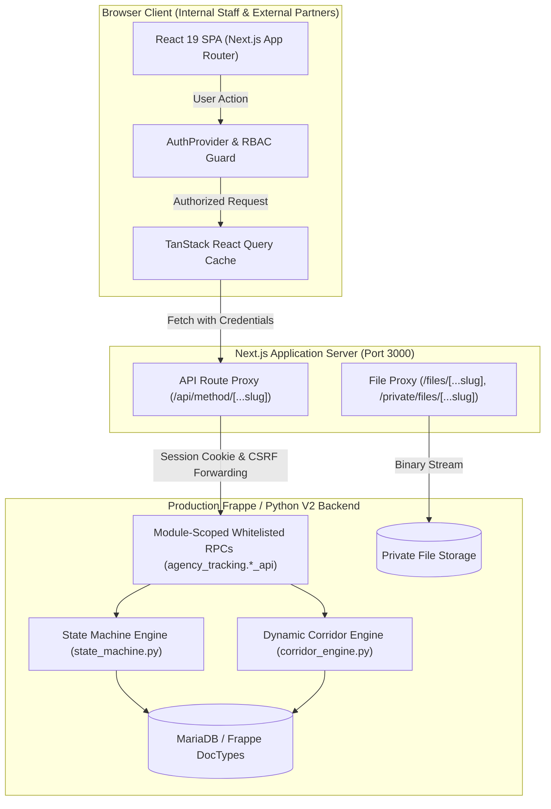

# Travel Agency Workflow (Frontend) — Engineering Master Guide

Welcome to the comprehensive reverse-engineering documentation and developer onboarding guide for the **Travel Agency Workflow Frontend**.

This documentation suite is designed for developers who are relatively new to JavaScript, React, and Next.js, as well as experienced engineers needing an authoritative, code-grounded reference of the system's architecture, data flows, business logic, user roles, and operational workflows.

---

## 1. What the Application Does & Who Uses It

The **Travel Agency Workflow Platform** is an enterprise-grade recruitment and placement operations system. It automates and tracks the complete legal pipeline of deploying Ethiopian domestic and skilled workers to overseas employers—specifically within the **Saudi Arabia** and **Kuwait** corridors—from initial candidate registration through government clearance, embassy visa stamping, flight ticketing, and airport departure.

### The People and Organizations Who Use This System

1. **Agency Registrars & Intake Officers:**
   Register candidates, scan passports with Optical Character Recognition (OCR), record bio-data, education, and medical checkup records.
2. **Clearance Officers & Country Step Specialists:**
   Coordinate and advance candidates through national and foreign labor clearance requirements:
   - **Saudi Arabia Corridor:** Labor Market Information System (LMIS), Injaz/Te'shir visa registration & biometrics, Wakala authorization, and Saudi Embassy visa stamping.
   - **Kuwait Corridor:** Kuwait LMIS (Police Ashara clearance), Telesign security clearance, and Kuwait Embassy visa stamping.
3. **Ticketing & Dispatch Coordinators:**
   Book airline itineraries, record flight numbers, upload electronic tickets, verify airport tax clearances, and log physical departures.
4. **Foreign Agency Partners (Recruitment Agencies in Riyadh, Jeddah, Kuwait City):**
   Access an isolated external partner portal (`/agent`) to browse sanitized candidate CVs, place reservations on workers, request replacements, track candidate progress, and communicate directly with the local agency.
5. **Finance Managers & Accountants:**
   Manage foreign currency exchange rates (USD/SAR/KWD to ETB), log and approve stage fee expenses, track contractor commissions, and reconcile payments.
6. **Complaint & Welfare Officers:**
   Track post-deployment candidate issues, employer grievances, and welfare disputes.
7. **System Administrators & Operations Managers:**
   Configure corridors, monitor SLA turnarounds, manage staff accounts and roles, and override stage gate blocks when exceptional circumstances arise.

---

## 2. High-Level Architecture Overview

The platform is split into a **modern Next.js 16 (React 19) frontend** and an **authoritative Python/Frappe V2 backend**:

### Core Architecture Highlights

- **BFF (Backend-For-Frontend) Proxy Pattern:**
  All browser requests target local Next.js API route handlers (`/api/method/[...slug]`). The server-side proxy forwards requests to the upstream Frappe backend, sanitizes cookies, attaches upstream security bypass headers, and streams binary exports (PDF/Excel) directly to the browser.
- **Backend-Owned State Transitions:**
  The frontend never directly updates an applicant's or placement's status field. Transitions (e.g. `register_applicant`, `advance_placement`, `start_clearance_step`, `complete_clearance_step`) are executed exclusively through backend Remote Procedure Calls (RPCs) governed by `state_machine.py`.
- **Dynamic Configuration Corridors:**
  Corridor steps (e.g. Injaz, LMIS, Telesign, Embassy) are not hardcoded numbers in the UI. They are dynamically fetched from the backend (`get_corridor_steps`), allowing new destination countries or clearance steps to be configured in data without rewriting frontend code.
- **Strict Role-Based Access Control (RBAC):**
  16 canonical backend roles govern permissions. The UI enforces role-based navigation and route guards, while the backend provides the definitive security enforcement.

---

## 3. Technology Stack Inventory

| Technology | Version | Purpose in this System |
| :--- | :--- | :--- |
| **Next.js** | `16.3.1` | App Router framework providing SSR/SSG, nested layouts, route guards, and server-side API proxying. |
| **React** | `19.2.8` | Component rendering engine utilizing hooks, Context API, and stateful interfaces. |
| **TypeScript** | `5.x` | Static type safety, interface contracts matching backend Swagger definitions, and strict prop checking. |
| **Tailwind CSS** | `4.x` | Modern styling engine using `@tailwindcss/postcss` and CSS variable theming for responsive light/dark modes. |
| **@tanstack/react-query**| `5.101.4` | Asynchronous server-state management, cache deduplication, and window refetching. |
| **@tanstack/react-table**| `9.1.2` | Headless table engine supporting sorting, filtering, and high-performance row virtualization. |
| **React Hook Form** | `7.85.0` | Performant form state handling with minimal re-renders during complex multi-step candidate registration. |
| **Zod** | `3.25.76` | Runtime schema validation and error message formatting for candidate intake. |
| **Radix UI** | Multiple | Accessible, unstyled headless UI primitives (Dialogs, Popovers, Tabs, Switches, Select). |
| **jsPDF / pdf-lib** | `4.2.1 / 1.17.1`| In-browser client-side PDF generation for standard Ethiopian CVs and agency bios. |
| **Tesseract.js** | `7.0.0` | Client-side Optical Character Recognition (OCR) for reading passport Machine Readable Zones (MRZ). |
| **Lucide React** | `1.31.0` | Unified system iconography. |
| **Sonner** | `2.0.8` | Notification toast engine for action confirmations and non-intrusive error toasts. |

---

## 4. Guide to the Engineering Documentation Suite

This documentation set is divided into 10 structured, progressive manuals:

| Document | Title | Purpose |
| :--- | :--- | :--- |
| [01-system-architecture.md](file:///c:/Users/azwis/OneDrive/Desktop/Doc/Pro/Internship/Travel%20Agency%20Workflow/Travel%20Agency%20Frontend/travel_agency_workflow/docs/engineering-guide/01-system-architecture.md) | **System Architecture** | Outside-in view of architectural layers, system boundaries, and technology trade-offs. |
| [02-repository-and-file-map.md](file:///c:/Users/azwis/OneDrive/Desktop/Doc/Pro/Internship/Travel%20Agency%20Workflow/Travel%20Agency%20Frontend/travel_agency_workflow/docs/engineering-guide/02-repository-and-file-map.md) | **Repository & File Map** | Directory tree and an exhaustive file-by-file catalog of every first-party file in the codebase. |
| [03-frontend-fundamentals.md](file:///c:/Users/azwis/OneDrive/Desktop/Doc/Pro/Internship/Travel%20Agency%20Workflow/Travel%20Agency%20Frontend/travel_agency_workflow/docs/engineering-guide/03-frontend-fundamentals.md) | **Frontend Fundamentals** | Step-by-step mentor guide teaching JS, TS, React, and Next.js through real code excerpts from this project. |
| [04-feature-walkthroughs.md](file:///c:/Users/azwis/OneDrive/Desktop/Doc/Pro/Internship/Travel%20Agency%20Workflow/Travel%20Agency%20Frontend/travel_agency_workflow/docs/engineering-guide/04-feature-walkthroughs.md) | **Feature Walkthroughs** | End-to-end traces of user journeys from button click to database commit and back. |
| [05-api-and-data-flow.md](file:///c:/Users/azwis/OneDrive/Desktop/Doc/Pro/Internship/Travel%20Agency%20Workflow/Travel%20Agency%20Frontend/travel_agency_workflow/docs/engineering-guide/05-api-and-data-flow.md) | **API & Data Flow** | Request lifecycle, proxy routing, CSRF management, error handling, and complete endpoint-to-feature matrix. |
| [06-authentication-and-permissions.md](file:///c:/Users/azwis/OneDrive/Desktop/Doc/Pro/Internship/Travel%20Agency%20Workflow/Travel%20Agency%20Frontend/travel_agency_workflow/docs/engineering-guide/06-authentication-and-permissions.md) | **Auth & Permissions** | Session cookies, `AuthProvider`, route guards, canonical roles, and partner portal isolation. |
| [07-design-decisions-and-tradeoffs.md](file:///c:/Users/azwis/OneDrive/Desktop/Doc/Pro/Internship/Travel%20Agency%20Workflow/Travel%20Agency%20Frontend/travel_agency_workflow/docs/engineering-guide/07-design-decisions-and-tradeoffs.md) | **Architectural Decisions & Trade-offs**| Senior engineering analysis of 12 major design patterns, evaluating pros, cons, and alternatives. |
| [08-developer-field-guide.md](file:///c:/Users/azwis/OneDrive/Desktop/Doc/Pro/Internship/Travel%20Agency%20Workflow/Travel%20Agency%20Frontend/travel_agency_workflow/docs/engineering-guide/08-developer-field-guide.md) | **Developer Field Guide** | Practical recipes for debugging, locating code, diagnosing errors, and safely modifying features. |
| [09-learning-roadmap.md](file:///c:/Users/azwis/OneDrive/Desktop/Doc/Pro/Internship/Travel%20Agency%20Workflow/Travel%20Agency%20Frontend/travel_agency_workflow/docs/engineering-guide/09-learning-roadmap.md) | **7-Stage Learning Roadmap** | Progressive self-study syllabus taking you from code reading to independent architecture and maintenance. |
| [10-self-assessment.md](file:///c:/Users/azwis/OneDrive/Desktop/Doc/Pro/Internship/Travel%20Agency%20Workflow/Travel%20Agency%20Frontend/travel_agency_workflow/docs/engineering-guide/10-self-assessment.md) | **Self-Assessment & Exercises** | Comprehension tests, non-destructive exercises, teach-back checkpoints, and answer keys. |

---

## 5. Suggested Reading Order

To build a confident, intuitive mental model of the application, follow this sequence:

1. **Stage 1: System Understanding**
   - Read this `README.md`.
   - Read [01-system-architecture.md](file:///c:/Users/azwis/OneDrive/Desktop/Doc/Pro/Internship/Travel%20Agency%20Workflow/Travel%20Agency%20Frontend/travel_agency_workflow/docs/engineering-guide/01-system-architecture.md) to understand where the frontend begins and where the backend takes over.
   - Read [06-authentication-and-permissions.md](file:///c:/Users/azwis/OneDrive/Desktop/Doc/Pro/Internship/Travel%20Agency%20Workflow/Travel%20Agency%20Frontend/travel_agency_workflow/docs/engineering-guide/06-authentication-and-permissions.md) to learn who can access what.
2. **Stage 2: Code Literacy & Repository Orientation**
   - Read [03-frontend-fundamentals.md](file:///c:/Users/azwis/OneDrive/Desktop/Doc/Pro/Internship/Travel%20Agency%20Workflow/Travel%20Agency%20Frontend/travel_agency_workflow/docs/engineering-guide/03-frontend-fundamentals.md) to ground yourself in the specific syntax and React patterns used here.
   - Use [02-repository-and-file-map.md](file:///c:/Users/azwis/OneDrive/Desktop/Doc/Pro/Internship/Travel%20Agency%20Workflow/Travel%20Agency%20Frontend/travel_agency_workflow/docs/engineering-guide/02-repository-and-file-map.md) as a continuous reference to locate files.
3. **Stage 3: Feature & Data Mastery**
   - Read [04-feature-walkthroughs.md](file:///c:/Users/azwis/OneDrive/Desktop/Doc/Pro/Internship/Travel%20Agency%20Workflow/Travel%20Agency%20Frontend/travel_agency_workflow/docs/engineering-guide/04-feature-walkthroughs.md) to follow complete candidate lifecycles.
   - Read [05-api-and-data-flow.md](file:///c:/Users/azwis/OneDrive/Desktop/Doc/Pro/Internship/Travel%20Agency%20Workflow/Travel%20Agency%20Frontend/travel_agency_workflow/docs/engineering-guide/05-api-and-data-flow.md) to master how the frontend talks to Frappe.
4. **Stage 4: Engineering Judgment & Daily Development**
   - Read [07-design-decisions-and-tradeoffs.md](file:///c:/Users/azwis/OneDrive/Desktop/Doc/Pro/Internship/Travel%20Agency%20Workflow/Travel%20Agency%20Frontend/travel_agency_workflow/docs/engineering-guide/07-design-decisions-and-tradeoffs.md) to learn how to evaluate code quality.
   - Keep [08-developer-field-guide.md](file:///c:/Users/azwis/OneDrive/Desktop/Doc/Pro/Internship/Travel%20Agency%20Workflow/Travel%20Agency%20Frontend/travel_agency_workflow/docs/engineering-guide/08-developer-field-guide.md) handy whenever debugging or making changes.
   - Complete the checkpoints in [10-self-assessment.md](file:///c:/Users/azwis/OneDrive/Desktop/Doc/Pro/Internship/Travel%20Agency%20Workflow/Travel%20Agency%20Frontend/travel_agency_workflow/docs/engineering-guide/10-self-assessment.md).
